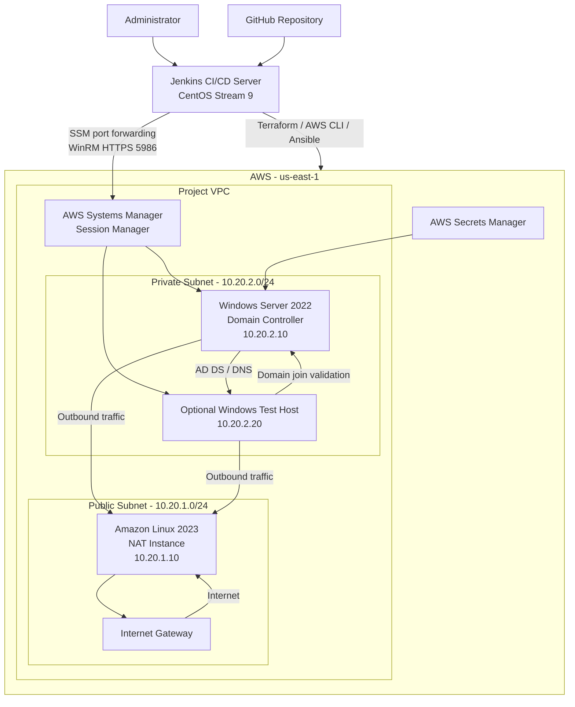

# Windows Server 2022 Active Directory Domain Services (AD DS) – AWS Automated Deployment


## Project Overview

This project automates the deployment of a Windows Server 2022 Active Directory Domain Services (AD DS) environment in Azure using Infrastructure as Code, configuration management, and a Jenkins CI/CD pipeline.

The solution provisions an AWS network, a Linux-based NAT instance, and private Windows EC2 instances. Ansible configures the Windows Domain Controller, installs and configures AD DS and DNS, creates the Active Directory organizational structure, imports domain accounts, and validates domain connectivity.

The deployment is designed to avoid exposing Windows servers directly to the public internet. AWS Systems Manager (SSM) provides remote management, while temporary SSM port-forwarding sessions allow Ansible to communicate with Windows hosts over WinRM HTTPS.

The Jenkins pipeline automates validation, security scanning, code analysis, approval, deployment, and controlled infrastructure destruction.


### Key objectives

- Build repeatable AWS infrastructure using Terraform.
- Deploy Windows Server 2022 without public IP addresses on the Windows instances.
- Configure a private network with controlled outbound internet access through a NAT instance.
- Automate Windows configuration and Active Directory setup with Ansible.
- Use AWS Systems Manager for private server management.
- Secure Ansible credentials using encrypted Ansible Vault data and Jenkins credentials.
- Validate Windows connectivity, domain configuration, organizational units, and domain accounts.
- Integrate Trivy and SonarQube into Jenkins CI/CD.
- Support controlled `APPLY` and `DESTROY` operations through a Jenkins build parameter.

---

## Architecture

### AWS network design

The AWS environment uses a VPC with separate public and private subnets.

| Component | Configuration |
| --- | --- |
| AWS Region | `us-east-1` |
| VPC | Project-specific VPC CIDR |
| Public subnet | `10.20.1.0/24` |
| Private subnet | `10.20.2.0/24` |
| NAT instance | Amazon Linux 2023 |
| NAT private IP | `10.20.1.10` |
| Domain Controller | Windows Server 2022 |
| DC private IP | `10.20.2.10` |
| Optional Windows client | Windows Server/client test instance, depending on deployment configuration |
| Client private IP | `10.20.2.20` |
| Active Directory domain | `pumejlab.com` |
| NetBIOS domain | `PUMEJLAB` |

**Important:** Windows instances are deployed in the private subnet. They do not require public IP addresses or direct inbound RDP exposure.

### Architecture diagram



### Network and management flow

1. Terraform creates the VPC, public and private subnets, route tables, internet gateway, security groups, and EC2 instances.
2. The Amazon Linux 2023 NAT instance provides outbound internet access for private instances.
3. The Windows Domain Controller and optional test host are deployed in the private subnet.
4. AWS Systems Manager manages the Windows instances without requiring public IP addresses or direct inbound RDP access.
5. The deployment script establishes temporary SSM port-forwarding sessions.
6. Ansible communicates with the Windows instances using WinRM over HTTPS on port `5986`.
7. The Domain Controller provides Active Directory and DNS services.
8. The optional Windows client validates domain joining and connectivity.

---

## Technology Stack

| Technology | Purpose |
| --- | --- |
| AWS | Cloud infrastructure |
| Terraform | Infrastructure provisioning |
| Amazon Linux 2023 | NAT instance |
| Windows Server 2022 | Active Directory Domain Controller |
| Ansible | Windows configuration and AD DS automation |
| PowerShell | Windows administration and configuration |
| WinRM HTTPS | Secure Ansible-to-Windows communication |
| AWS Systems Manager | Private instance management and port forwarding |
| AWS Secrets Manager | Bootstrap secret management |
| Ansible Vault | Encrypted Ansible secrets |
| Jenkins | CI/CD orchestration |
| Trivy | Vulnerability, misconfiguration, and secret scanning |
| SonarQube | Static code analysis |
| GitHub | Source control |

---

## Repository Structure

The project separates AWS infrastructure, Windows automation, deployment scripts, and Jenkins pipeline configuration.

```text
aws-windows-adlab/
│
├── aws-ad-lab-terraform/
│   ├── main.tf
│   ├── network.tf
│   ├── variables.tf
│   ├── outputs.tf
│   ├── versions.tf
│   └── ...
│
├── playbooks/
│   ├── connection_test.yml
│   ├── ...
│
├── group_vars/
│   └── vault.yml
│
├── logs/
│
├── startupadds-aws.sh
├── Jenkinsfile
├── requirements-ansible.txt
├── ansible.cfg
├── .gitignore
└── README.md
```

The actual repository may contain additional Terraform files, Ansible playbooks, variable files, templates, and supporting scripts.

**Security note:** `group_vars/vault.yml` contains encrypted Ansible Vault data. It must be present in the deployment workspace and tracked in Git in its encrypted form. The Jenkins Vault password credential is separate from this encrypted file.

---

## AWS Infrastructure Provisioning

Terraform provisions the AWS environment.

### Infrastructure components

- VPC and subnet configuration.
- Internet Gateway and public routing.
- Private subnet and private route table.
- Amazon Linux 2023 NAT instance.
- NAT instance security group and forwarding configuration.
- Windows security group.
- Windows Server 2022 Domain Controller.
- Optional Windows test/client instance.
- IAM permissions and instance profiles required for Systems Manager.
- AWS Secrets Manager integration for bootstrap credentials.

### Network security

The Windows security group restricts access to the project network and required management paths.

The NAT instance provides controlled outbound connectivity for private Windows instances.

The security groups include intentional HTTP/HTTPS egress exceptions. Trivy identified these rules as public-destination egress findings (`AVD-AWS-0104`). Rather than changing the NAT and Windows outbound networking design, documented inline Trivy suppressions were added to the affected security group resources.

These suppressions expire on **February 1, 2027**, and must be reassessed before that date.

The exception does not mean public egress has been eliminated. The documented rules permit outbound TCP 80 and 443 because the NAT instance needs to forward internet traffic and private Windows servers require outbound connectivity for updates, Systems Manager, and downloads.

---

## Active Directory Configuration

The deployment creates the Active Directory environment using Windows Server 2022.

| Setting | Value |
| --- | --- |
| Domain controller hostname | `DC01` |
| Domain name | `pumejlab.com` |
| NetBIOS name | `PUMEJLAB` |
| DC private IP | `10.20.2.10` |
| DNS | Domain Controller |
| Windows management | WinRM HTTPS |
| WinRM port | `5986` |

### Active Directory automation

Ansible and PowerShell automate the following:

- Install the Active Directory Domain Services role.
- Install and configure DNS.
- Promote Windows Server 2022 to a Domain Controller.
- Configure the Active Directory domain.
- Create the required organizational units.
- Import domain users from the project's user data.
- Configure and validate domain membership.
- Verify connectivity to the Domain Controller.

The project validates six organizational units and 119 domain accounts in the configured AD environment.

### Organizational structure

The Active Directory organizational structure includes:

- Admins
- Management
- IT
- HR
- Marketing
- Sales

The automation is designed to make the environment repeatable rather than requiring manual creation of users and OUs through Active Directory Users and Computers.

---

## Secure Windows Management with AWS SSM and WinRM

A major design decision is to keep Windows instances private while still allowing Ansible automation from Jenkins.

### SSM management

AWS Systems Manager is used to:

- Verify that EC2 instances are registered and available.
- Execute bootstrap and validation commands.
- Retrieve or validate required Windows configuration.
- Establish temporary port-forwarding sessions.
- Avoid exposing WinRM or RDP directly to the internet.

### WinRM HTTPS

Ansible connects to Windows using WinRM HTTPS on port `5986`.

The deployment creates temporary local SSM forwarding ports:

| Windows host | Local forwarding port | Remote port |
| --- | ---: | ---: |
| DC01 | `15986` | `5986` |
| Optional client | `15987` | `5986` |

The Ansible inventory uses the Windows computer names as connection hostnames, while the deployment script temporarily maps those hostnames to `127.0.0.1` on the Jenkins controller.

This allows the Windows host's expected hostname to be used for the WinRM connection while the actual network traffic travels through the local SSM tunnel.

The inventory uses WinRM HTTPS with NTLM authentication and certificate validation configured for the project's lab certificate setup.

### Python dependencies

The Ansible controller requires the Python WinRM library.

Install it in the Python environment used by Ansible:

```bash
# Install Windows Remote Management support.
python3 -m venv .venv
source .venv/bin/activate
python3 -m pip install --upgrade pip
python3 -m pip install -r requirements.txt
python3 -m pip install pywinrm requests-ntlm
```

The Jenkins server uses a dedicated Ansible environment at:

```text
/opt/jenkins-tools/ansible
```

Install the dependency there:

```bash
# Install the WinRM libraries into the Jenkins Ansible environment.
sudo /opt/jenkins-tools/ansible/bin/python -m pip install \
    pywinrm requests-ntlm

# Verify the WinRM module can be imported.
sudo /opt/jenkins-tools/ansible/bin/python -c \
'import winrm; print("pywinrm:", winrm.__version__)'
```

The deployment must use the same Python environment in which these dependencies are installed.

---

## Ansible Automation

Ansible handles the Windows configuration and Active Directory setup after Terraform provisions the infrastructure.

### Automation workflow

1. Validate the deployment prerequisites.
2. Validate AWS credentials and the selected AWS region.
3. Validate the encrypted Ansible Vault data and password file.
4. Check EC2 instance readiness.
5. Verify SSM availability.
6. Establish SSM port-forwarding sessions.
7. Validate WinRM HTTPS connectivity.
8. Run the Windows connection test playbook.
9. Configure the Domain Controller.
10. Install and promote AD DS.
11. Configure DNS and Active Directory.
12. Create OUs and import domain users.
13. Join and validate the optional Windows client.
14. Run post-deployment checks.

### Windows connectivity test

The project includes:

```text
playbooks/connection_test.yml
```

This playbook verifies that Ansible can communicate with the Windows Domain Controller using the configured WinRM connection.

A successful connection test is an important checkpoint before executing the AD DS configuration playbooks.

### Ansible Vault

Sensitive values are protected using Ansible Vault.

The encrypted file:

```text
group_vars/vault.yml
```

contains protected automation data.

The Jenkins credential:

```text
ansible-vault-password-file
```

provides the password needed to decrypt the file.

These are two separate requirements:

- The encrypted `vault.yml` file must exist in the workspace.
- The Vault password credential must be available to the pipeline.

Having the password file alone does not replace the encrypted Ansible Vault data file.

---

## Automated Deployment Script

The main AWS deployment entry point is:

```bash
./startupadds-aws.sh
```

The script coordinates Terraform, AWS CLI, Systems Manager, Ansible, and Windows validation.

### Deployment responsibilities

- Validate required local tools and project files.
- Validate AWS authentication.
- Initialize and apply the Terraform infrastructure.
- Read Terraform outputs and instance information.
- Validate Windows instance and SSM readiness.
- Retrieve or validate bootstrap credentials.
- Establish temporary hostname mappings.
- Establish SSM port-forwarding sessions.
- Execute Ansible playbooks.
- Validate Active Directory and domain membership.
- Clean up temporary hostname mappings and SSM tunnels.
- Write deployment logs.

### Deployment logs

Logs are stored in:

```text
logs/
```

Each deployment generates a timestamped log file.

Example:

```text
logs/startupadds-20261031-230158.log
```

The script uses cleanup handling to stop temporary SSM sessions and remove temporary hostname mappings when deployment exits.

**Operational note:** If the script reports that it could not remove the temporary `/etc/hosts` block, inspect `/etc/hosts` on the Jenkins controller and remove only the marked deployment block after confirming that it is no longer needed. Do not overwrite the entire hosts file.

---

## Jenkins CI/CD Integration

Jenkins runs on a CentOS Stream 9 VM and automates the AWS deployment pipeline.

### Jenkins configuration

| Item | Configuration |
| --- | --- |
| Jenkins server | `jenkinsServer` |
| Jenkins home | `/var/lib/jenkins` |
| Jenkins job | `windows-adds-aws-deployment` |
| Repository branch | `main` |
| Jenkinsfile | `Jenkinsfile-AWS` |
| AWS region | `us-east-1` |
| Ansible environment | `/opt/jenkins-tools/ansible` |
| SonarQube server configuration | `SonarQube-Local` |
| SonarQube Scanner installation | `SonarScanner` |
| SonarQube project key | `aws-windows-ad-lab` |

### Jenkins credentials

The pipeline uses Jenkins credentials rather than hardcoding AWS or Ansible secrets in the Jenkinsfile.

| Credential ID | Purpose |
| --- | --- |
| `pumej_aws_access_id` | AWS access key ID |
| `pumej_aws_secret_key` | AWS secret access key |
| `ansible-vault-password-file` | Ansible Vault password file |

These credentials must exist in Jenkins before running the deployment pipeline.

### Jenkins pipeline stages

The pipeline includes the following stages:

1. **SCM Checkout** – Retrieves the project from GitHub.
2. **Pre-deployment Validation** – Checks required tools, files, and configuration.
3. **Trivy Security Scan** – Scans the repository and Terraform configuration.
4. **SonarQube Analysis** – Runs static code analysis.
5. **SonarQube Quality Gate** – Evaluates the analysis result.
6. **Deployment Approval** – Requires approval before an `APPLY` deployment.
7. **Deploy AWS Active Directory** – Executes `startupadds-aws.sh`.
8. **Destroy Plan** – Generates and displays a Terraform destroy plan when `DESTROY` is selected.
9. **Destroy Approval** – Requires explicit approval before infrastructure removal.
10. **Destroy AWS Environment** – Applies the reviewed destroy plan.
11. **Deployment Summary** – Reports the deployment result.
12. **Destroy Summary** – Reports the destruction result.

The pipeline uses timestamps, prevents concurrent deployments, and has a four-hour timeout for the overall job.

### Trivy security scanning

Trivy is used to scan for:

- Vulnerabilities.
- Infrastructure-as-Code misconfigurations.
- Exposed secrets.

The pipeline is configured to report or fail on HIGH and CRITICAL findings according to the Jenkinsfile's scan settings.

The Terraform egress exceptions documented in `network.tf` use inline Trivy suppression comments with an expiration date. These suppressions should be reviewed rather than treated as permanent exclusions.

### SonarQube code analysis

SonarQube analyzes the project source code and reports code quality and security findings.

The Jenkins configuration uses:

- Server installation: `SonarQube-Local`
- Scanner installation: `SonarScanner`
- Project key: `aws-windows-ad-lab`
- Jenkins webhook endpoint: `/sonarqube-webhook/`

The SonarQube webhook should be configured to point to the Jenkins endpoint so that the pipeline can receive quality gate results.

### APPLY and DESTROY parameter

The Jenkins job includes an `ACTION` choice parameter:

```groovy
parameters {
    choice(
        name: 'ACTION',
        choices: ['APPLY', 'DESTROY'],
        description: 'Choose APPLY to deploy or DESTROY to remove the AWS AD lab.'
    )
}
```

**APPLY** is the default selection.

| Action | Behavior |
| --- | --- |
| `APPLY` | Runs validation, security scans, code analysis, approval, and AWS deployment. |
| `DESTROY` | Runs validation, security scans, code analysis, generates a Terraform destroy plan, requests approval, and removes the AWS environment after approval. |

A normal GitHub push webhook does not automatically select `DESTROY`. It triggers the job using the default parameter value, which is `APPLY`.

To select `DESTROY`, use Jenkins **Build with Parameters** and choose `DESTROY`, or use an authenticated parameterized Jenkins API request.

Example:

```bash
# Trigger a parameterized Jenkins build.
# Replace the placeholders with the appropriate Jenkins values.
curl -X POST \
  -u "JENKINS_USER:JENKINS_API_TOKEN" \
  "http://JENKINS_SERVER:8080/job/windows-adds-aws-deployment/buildWithParameters?ACTION=DESTROY"
```

Use a protected Jenkins endpoint and API token. Do not expose Jenkins credentials in scripts, logs, or source control.

**Destroy safety:** The Terraform destroy operation must use the same backend, workspace, variables, and state as the original deployment. Review the generated destroy plan carefully before approving it. Do not run the `DESTROY` action until the Jenkins execution environment has been verified to use the correct Terraform state.

---

## Jenkins Host Prerequisites and Troubleshooting

### Jenkins Ansible environment

The Jenkins controller requires the appropriate Ansible and Windows connection dependencies.

Example dependency installation:

```bash
# Install Windows remoting dependencies into Jenkins' Ansible environment.
sudo /opt/jenkins-tools/ansible/bin/python -m pip install \
    pywinrm requests-ntlm

# Verify Ansible is available.
sudo /opt/jenkins-tools/ansible/bin/ansible-playbook --version

# Verify the WinRM Python module.
sudo /opt/jenkins-tools/ansible/bin/python -c \
'import winrm; print("WinRM Python module available")'
```

The pipeline and deployment script must use this same Ansible environment.

### Jenkins sudo permissions

The deployment script requires elevated permissions for specific local operations, including:

- Updating temporary hostname mappings in `/etc/hosts`.
- Managing sudo authentication during deployment.
- Inspecting local listening ports and SSM tunnel processes.

During Jenkins integration, the `jenkins` service account initially failed because it was not authorized to run sudo.

The lab server was configured with the following group membership:

```bash
# Add the Jenkins service account to the wheel group.
sudo usermod -aG wheel jenkins

# Verify the account's group membership.
id jenkins

# Validate sudoers syntax.
sudo visudo -c
```

The CentOS sudoers configuration already grants the wheel group passwordless sudo:

```text
%wheel ALL=(ALL) NOPASSWD: ALL
```

The Jenkins service was restarted to load the new supplementary group membership.

**Security warning:** This configuration grants Jenkins unrestricted passwordless root access on the Jenkins VM. It is a lab convenience, not a recommended production configuration. A production implementation should use narrowly scoped sudo permissions and isolate Jenkins build agents.

### Useful troubleshooting commands

```bash
# Check Jenkins service status.
sudo systemctl status jenkins --no-pager

# Inspect Jenkins service logs.
sudo journalctl -u jenkins -n 100 --no-pager

# Check Jenkins sudo permissions.
sudo -l -U jenkins

# Check Jenkins group membership.
id jenkins

# Check the Ansible interpreter and version.
sudo /opt/jenkins-tools/ansible/bin/ansible-playbook --version

# Check whether the WinRM Python module is installed.
sudo /opt/jenkins-tools/ansible/bin/python -m pip show pywinrm

# Check for temporary Windows host mappings.
grep -n -E 'DC01|CLIENT|AWS AD lab' /etc/hosts
```

---

## Deployment Prerequisites

Before running the AWS deployment, ensure the following are available.

### Local development environment

- AWS account with permissions to create and manage the required resources.
- AWS CLI configured with appropriate credentials.
- Terraform installed.
- Ansible installed in the project's Python virtual environment.
- Python and required Ansible packages.
- Required Ansible collections.
- Git.
- Trivy.
- SonarQube Scanner if running local analysis outside Jenkins.

### AWS requirements

- AWS account and access credentials.
- Correct AWS region (`us-east-1`).
- Required EC2, VPC, IAM, SSM, and Secrets Manager permissions.
- Appropriate Windows Server 2022 AMI availability.
- Required network connectivity and instance profile permissions.

### Jenkins requirements

- Jenkins running on the CentOS Stream 9 VM.
- GitHub repository access.
- AWS credentials configured in Jenkins.
- Ansible Vault password credential configured.
- Terraform installed and available to Jenkins.
- AWS CLI installed and configured through Jenkins credentials.
- Session Manager plugin installed.
- Ansible and `pywinrm` dependencies installed in the Jenkins Ansible environment.
- Trivy installed.
- SonarQube server and scanner configured.
- SonarQube webhook configured.

---

## Local Deployment

The primary AWS deployment script is:

```bash
./startupadds-aws.sh
```

Before running it, validate your AWS identity:

```bash
# Confirm the AWS account and identity being used.
aws sts get-caller-identity

# Confirm the configured region.
aws configure get region
```

Then run the deployment:

```bash
# Start the AWS AD DS deployment.
./startupadds-aws.sh
```

Review the generated log under `logs/` and confirm the final success message.

---

## Validation and Testing

The project uses multiple validation checkpoints.

### Infrastructure validation

- Confirm Terraform apply completes successfully.
- Confirm the expected EC2 instances are running.
- Confirm the Domain Controller and optional client have the expected private IP addresses.
- Confirm the private instances are registered with Systems Manager.

### Windows connectivity validation

- Confirm SSM commands execute successfully.
- Confirm SSM port forwarding is established.
- Confirm WinRM HTTPS connectivity on port `5986`.
- Confirm Ansible can execute the Windows connection test.

### Active Directory validation

- Confirm the Domain Controller is promoted successfully.
- Confirm the domain is `pumejlab.com`.
- Confirm the expected organizational units exist.
- Confirm the expected domain accounts are imported.
- Confirm the optional client joins the domain successfully.

### Example successful validation output

A successful deployment previously reported:

```text
CLIENT_DOMAIN_OK: pumejlab.com
```

The Ansible play recaps completed without failed or unreachable hosts, and the deployment script reported:

```text
[SUCCESS] AWS Active Directory deployment completed.
```

These are examples of successful validation from a completed deployment, not a guarantee that every future deployment will produce identical results.

---

## Security Considerations

Security is incorporated throughout the project.

- Windows instances remain in a private subnet.
- No direct public RDP access is required.
- AWS Systems Manager is used for remote management.
- WinRM communication uses HTTPS.
- Ansible secrets are encrypted with Ansible Vault.
- AWS credentials are stored in Jenkins credentials.
- Infrastructure is provisioned using Terraform.
- Trivy checks for vulnerabilities, misconfigurations, and secrets.
- SonarQube performs source-code analysis.
- Jenkins requires approval before deployment and destruction.
- Terraform destroy plans are generated before infrastructure removal.

### Known lab trade-offs

- The NAT instance provides outbound connectivity and is a single-instance dependency.
- Documented Trivy egress suppressions require reassessment before February 1, 2027.
- The Jenkins lab configuration grants the Jenkins account broad sudo privileges through the wheel group.
- The lab's WinRM certificate-validation configuration is designed for its controlled environment and should be hardened for production.
- AWS deployment costs continue while provisioned EC2, storage, and related resources remain active.

---

## Cleanup and Resource Destruction

The Jenkins pipeline provides a `DESTROY` option.

Before destroying the environment:

1. Confirm the correct AWS account and region.
2. Confirm the Terraform backend and workspace.
3. Confirm the state file represents the environment being destroyed.
4. Review the generated Terraform destroy plan.
5. Obtain the required Jenkins approval.
6. Verify that the AWS resources have been removed.

Do not manually delete Terraform state files as a substitute for destroying infrastructure.

The destroy operation should use the same Terraform state and configuration that were used to create the environment.

---

## Future Enhancement: Azure Deployment

The AWS environment is the first cloud implementation of this Active Directory automation project.

The next phase will extend the deployment to Microsoft Azure and integrate the Azure deployment into Jenkins CI/CD.

Planned Azure implementation:

- Azure resource group and virtual network.
- Public and private subnet architecture.
- Windows Server 2022 Domain Controller.
- Optional Windows client for domain validation.
- Azure networking and security controls.
- Terraform infrastructure provisioning.
- Ansible Windows configuration and AD DS automation.
- Secure Azure authentication using a service principal or managed identity.
- Azure remote Terraform state using Azure Storage.
- Jenkins pipeline integration for Azure deployment.
- Trivy and SonarQube security and code-quality scanning.
- Separate approval and destruction workflows.

The intention is to maintain consistent Active Directory configuration and validation across both cloud providers while adapting infrastructure and authentication to each platform.

---

## Skills Demonstrated

| Area | Skills |
| --- | --- |
| Cloud infrastructure | AWS VPC, EC2, IAM, SSM, Secrets Manager |
| Infrastructure as Code | Terraform modules, resources, variables, outputs, state |
| Windows administration | Windows Server 2022, PowerShell, AD DS, DNS |
| Active Directory | Domains, OUs, users, domain joining |
| Configuration management | Ansible, inventories, playbooks, Vault |
| Network security | Public/private subnets, NAT, security groups, WinRM HTTPS |
| Automation | Bash, Python, PowerShell |
| CI/CD | Jenkins declarative pipelines, approvals, parameters |
| DevSecOps | Trivy, SonarQube, quality gates |
| Source control | Git, GitHub |
| Troubleshooting | SSM, WinRM, IAM, Terraform, Jenkins, Linux administration |

---

## Project Outcome

This project demonstrates an automated Windows Server 2022 Active Directory deployment in AWS using Terraform, Ansible, AWS Systems Manager, and Jenkins.

It brings together cloud infrastructure provisioning, Windows systems administration, Active Directory automation, private network design, secure remote management, configuration management, and DevSecOps practices.

The Jenkins pipeline provides a repeatable workflow for validating, scanning, approving, deploying, and planning the destruction of the AWS environment.

The next development milestone is to implement the equivalent Azure deployment and integrate it into Jenkins, extending the project into a multi-cloud Active Directory automation portfolio.
