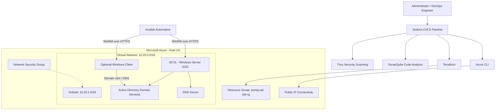
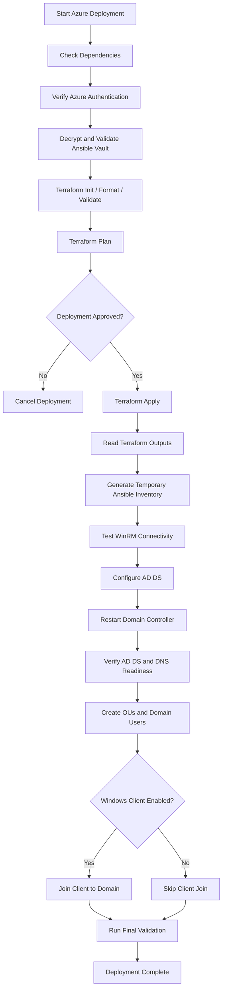

# Azure Windows Server 2022 Active Directory Domain Services (AD DS) Lab


## Project Overview

This project automates the deployment and configuration of a Windows Server 2022 Active Directory Domain Services (AD DS) environment in Microsoft Azure.

It combines **Infrastructure as Code (IaC)**, configuration management, Windows administration, cloud networking, and CI/CD automation to create a functional Active Directory lab.

Terraform provisions the Azure infrastructure, Azure CLI supports authentication and VM management, and Ansible configures Windows Server and Active Directory through WinRM.

The environment includes a Windows Server 2022 domain controller and an optional Windows client that can be joined to the domain.

The project demonstrates practical skills in:

- Microsoft Azure infrastructure provisioning
- Terraform infrastructure automation
- Windows Server administration
- Active Directory Domain Services
- DNS and domain management
- Ansible configuration management
- PowerShell automation
- Secure cloud access and credential management
- Jenkins CI/CD pipeline implementation
- Infrastructure security scanning

## Project Objectives

The primary objectives are to:

1. Provision Azure infrastructure using Terraform.
2. Deploy a Windows Server 2022 domain controller.
3. Configure Active Directory Domain Services.
4. Configure DNS and establish the Active Directory domain.
5. Create organizational units (OUs).
6. Automate domain user creation from a CSV file.
7. Provision an optional Windows client.
8. Join the Windows client to the Active Directory domain.
9. Validate domain controller, DNS, and client connectivity.
10. Automate deployment and destruction through Jenkins.

## Architecture

### High-level architecture diagram



### Architecture components

| Component | Description |
| --- | --- |
| Microsoft Azure | Cloud infrastructure platform |
| Resource Group | Contains the lab's Azure resources |
| Virtual Network | Provides private network connectivity |
| Subnet | Hosts the Windows virtual machines |
| Network Security Group | Controls permitted network traffic |
| DC01 | Windows Server 2022 domain controller |
| Active Directory | Provides centralized identity and domain management |
| DNS | Supports domain name resolution |
| Windows Client | Optional domain-joined workstation |
| Terraform | Provisions and manages Azure infrastructure |
| Azure CLI | Authenticates and performs Azure VM operations |
| Ansible | Automates Windows configuration through WinRM |
| PowerShell | Supports Windows-specific administration tasks |
| Jenkins | Orchestrates deployment, validation, and destruction |

**Note:** The diagram represents the intended logical architecture. Confirm the final NSG rules, client DNS configuration, and connectivity against the deployed Terraform resources before treating every connection as validated.

## Azure Environment Configuration

The project uses the following Terraform configuration values.

| Setting | Configuration |
| --- | --- |
| Cloud provider | Microsoft Azure |
| Azure region | East US |
| Resource group | `pumej-ad-lab-rg` |
| Project name | `pumej-ad` |
| Domain name | `pumejlab.com` |
| NetBIOS name | `PUMEJLAB` |
| Virtual network | `10.20.0.0/16` |
| Subnet | `10.20.1.0/24` |
| Domain controller | `DC01` |
| VM size | `Standard_B2ms` |
| OS disk size | 60 GB |
| Local administrator | `labadmin` |
| Optional Windows client | Enabled by default |

The VM size and deployment options can be adjusted through Terraform variables.

**Important:** The VM size shown above is the value in the current `terraform.tfvars`. The variable declaration has a different default, so review the active `.tfvars` file when changing deployment settings.

## Technology Stack

| Technology | Purpose |
| --- | --- |
| Microsoft Azure | Cloud infrastructure |
| Terraform | Infrastructure as Code |
| AzureRM Provider | Terraform integration with Azure |
| Azure CLI | Azure authentication and VM management |
| Ansible | Configuration management |
| Ansible Vault | Protects sensitive credentials |
| WinRM | Remote Windows management |
| PowerShell | Windows and Active Directory administration |
| Windows Server 2022 | Domain controller operating system |
| Active Directory DS | Centralized identity and authentication |
| DNS | Active Directory name resolution |
| Jenkins | CI/CD orchestration |
| Trivy | Filesystem and Terraform security scanning |
| SonarQube | Source code and configuration analysis |
| Git | Version control |

### Directory and file descriptions

**`azure-ad-lab-terraform/`**

Contains the Terraform configuration for provisioning Azure resources, including the resource group, networking, virtual machines, and associated infrastructure.

**`playbooks/`**

Contains Ansible playbooks for:

- Testing WinRM connectivity.
- Configuring the domain controller.
- Creating Active Directory organizational units and users.
- Joining the optional Windows client to the domain.
- Validating the deployment.

**`group_vars/`**

Contains shared Windows configuration variables and encrypted Ansible Vault credentials.

**`inventory/`**

Contains Ansible inventory configuration used for Windows management.

**`files/`**

Contains the CSV source data used for automated domain user creation.

**`scripts/`**

Contains supporting PowerShell automation.

**`startupadds-azure.sh`**

Orchestrates the Azure deployment workflow, including Terraform provisioning, Azure VM operations, Ansible configuration, and deployment validation.

**`Jenkinsfile-Azure`**

Defines the Azure deployment and destruction CI/CD workflow.

## Infrastructure Provisioning with Terraform

Terraform is responsible for creating and managing the Azure infrastructure.

The Terraform configuration is organized into logical components.

### Infrastructure resources

The deployment includes the following resource categories:

- Azure Resource Group
- Virtual Network
- Subnet
- Network Security Group and security rules
- Network interfaces
- Public IP connectivity
- Windows Server virtual machines
- OS disks and supporting compute resources

The domain controller is named `DC01`. The optional Windows client is controlled by the `deploy_client` Terraform variable.

### Terraform variables

Example configuration:

```hcl
# Azure subscription and deployment location.
location            = "East US"
resource_group_name = "pumej-ad-lab-rg"
project_name        = "pumej-ad"

# Active Directory domain configuration.
domain_name  = "pumejlab.com"
netbios_name = "PUMEJLAB"

# Azure virtual network configuration.
vnet_address_space    = ["10.20.0.0/16"]
subnet_address_prefix = "10.20.1.0/24"

# Enable or disable the optional Windows client.
deploy_client = true

# Virtual machine configuration.
vm_size         = "Standard_B2ms"
admin_username  = "labadmin"
os_disk_size_gb = 60
```

The subscription ID, trusted administrator CIDR, and passwords should be supplied through appropriately protected configuration and credential mechanisms.

Do not copy personal subscription identifiers or public IP addresses into public documentation.

### Initialize and validate Terraform

```bash
# Navigate to the Azure Terraform directory.
cd azure-ad-lab-terraform

# Initialize the AzureRM provider and Terraform working directory.
terraform init

# Format Terraform configuration files.
terraform fmt -recursive

# Validate the Terraform configuration.
terraform validate

# Review the infrastructure changes before deployment.
terraform plan
```

### Deploy infrastructure

The recommended deployment method is the project orchestration script described below, which coordinates Terraform and Ansible.

For direct Terraform operations, review the plan and supply the required sensitive variables securely before applying.

```bash
# Apply the reviewed Terraform configuration.
terraform apply
```

## Active Directory Configuration

After Azure infrastructure provisioning, Ansible configures the Windows Server domain controller.

### Domain controller configuration

The domain controller is configured with:

| Setting | Value |
| --- | --- |
| Hostname | `DC01` |
| Operating system | Windows Server 2022 |
| Domain | `pumejlab.com` |
| NetBIOS | `PUMEJLAB` |
| AD DS | Installed and configured |
| DNS | Installed and configured |

### Active Directory Domain Services

The domain controller automation performs the following tasks:

1. Establishes authenticated WinRM connectivity.
2. Installs the Active Directory Domain Services role.
3. Installs the required management tools.
4. Promotes the Windows Server to a domain controller.
5. Configures the Active Directory domain.
6. Reboots the domain controller when required.
7. Waits for the domain controller to become available.
8. Verifies AD DS and DNS service readiness.
9. Re-establishes authenticated domain access.

The deployment script uses Azure VM Run Command to perform readiness checks after domain controller promotion and reboot.

### Organizational Units

The Active Directory structure is designed to organize users by department.

| Organizational Unit | Purpose |
| --- | --- |
| Admins | Administrative accounts |
| Management | Management department |
| IT | Information Technology |
| HR | Human Resources |
| Marketing | Marketing department |
| Sales | Sales department |

The OU structure provides a foundation for centralized user administration and future Group Policy configuration.

### Automated domain user creation

User account information is maintained in:

```text
files/user_accounts_final.csv
```

The user provisioning workflow uses Ansible and PowerShell to process the CSV and create Active Directory accounts.

The workflow is designed to:

- Read user records from CSV.
- Create the required organizational units.
- Create user accounts in their designated OUs.
- Configure user attributes.
- Apply the intended account settings.
- Support repeatable configuration management.

### Windows client domain join

The project supports an optional Windows client.

When enabled, the deployment workflow:

1. Provisions the client VM.
2. Establishes remote WinRM connectivity.
3. Configures the client to use the domain controller for DNS.
4. Joins the client to `pumejlab.com`.
5. Validates domain membership and connectivity.

**Important:** Active Directory domain joining depends on correct DNS configuration. The client must resolve the domain using the domain controller's DNS service. Verify that the Azure network and client NIC DNS settings point to DC01 before attempting the domain join.

If `deploy_client` is disabled, the client deployment and domain-join stages are skipped.

## Ansible Configuration Management

Ansible manages the Windows configuration after Terraform provisions the infrastructure.

### WinRM connectivity

Ansible communicates with Windows Server using WinRM over HTTPS.

The Azure deployment workflow uses:

- WinRM port `5986`
- NTLM authentication
- Ansible Windows connection plugins
- Ansible Vault for protected credentials

The deployment script generates a temporary inventory using the Terraform outputs.

This allows Ansible to target the provisioned Windows VMs without requiring manually maintained public IP addresses.

### Ansible playbooks

| Playbook | Purpose |
| --- | --- |
| `connection_test.yml` | Tests authenticated Windows connectivity |
| `domain_controller.yml` | Installs and configures AD DS |
| `domain_users.yml` | Creates OUs and domain users |
| `domain_client.yml` | Joins the Windows client to the domain |
| `validate_deployment.yml` | Validates the AD DS deployment |
| `validate_client.yml` | Validates the Windows client |

### Ansible Vault

Sensitive information is protected using Ansible Vault.

The encrypted Vault file is:

```text
group_vars/vault.yml
```

It contains sensitive configuration such as:

- Bootstrap administrator password
- Domain administrator password
- Directory Services Restore Mode (DSRM) password

The Vault password must be supplied securely at runtime.

Example:

```bash
# Decrypt the Vault file only when required for inspection.
ansible-vault view group_vars/vault.yml
```

Never commit decrypted Vault data, password files, or credentials to Git.

## Automated Deployment

The primary deployment entry point is:

```bash
./startupadds-azure.sh
```

The script coordinates the Terraform, Azure CLI, and Ansible deployment workflow.

### Deployment workflow



### Prerequisites

Before deployment, install and configure:

- Microsoft Azure subscription
- Azure CLI
- Terraform
- Python 3
- Ansible
- Required Ansible collections
- PyYAML
- Git
- Network connectivity to the Azure management endpoints
- Ansible Vault password file

The Jenkins agent must also have the tools required by the CI/CD pipeline.

### Authenticate to Azure

```bash
# Authenticate interactively to Microsoft Azure.
az login

# Select the subscription used by the Terraform configuration.
az account set --subscription "<YOUR_AZURE_SUBSCRIPTION_ID>"

# Verify the selected Azure subscription.
az account show --output table
```

### Activate the Python virtual environment

```bash
# Activate the project's Ansible environment.
source .venv/bin/activate

# Confirm the active Ansible installation.
ansible --version
```

### Configure Ansible Vault access

For local deployment, the script can use the configured Vault password file.

```bash
# Point Ansible to the local Vault password file.
export ANSIBLE_VAULT_PASSWORD_FILE="$HOME/.ansible_vault_pass"

# Confirm the file is readable without printing its contents.
test -r "$ANSIBLE_VAULT_PASSWORD_FILE"
```

### Run deployment

```bash
# Execute the complete Azure AD DS deployment workflow.
./startupadds-azure.sh
```

Review the Terraform plan and deployment confirmation before allowing resources to be created.

### Deployment outputs

The orchestration script retrieves Terraform outputs such as:

- Resource group name
- Domain name
- NetBIOS name
- Domain controller private IP
- Domain controller public IP
- Optional client private IP
- Optional client public IP

These outputs are used to configure the temporary Ansible inventory and continue the deployment.

## Jenkins CI/CD Pipeline

The project includes a dedicated Azure pipeline:

```text
Jenkinsfile-Azure
```

The pipeline is designed to automate security analysis, deployment approval, Azure provisioning, and infrastructure destruction.

### Pipeline operations

The pipeline supports two selectable operations.

| Action | Description |
| --- | --- |
| `APPLY` | Deploy Azure infrastructure and configure Active Directory |
| `DESTROY` | Generate and review a Terraform destruction plan, then remove the infrastructure after approval |

### Pipeline stages

1. SCM Checkout
2. Pre-deployment Checks
3. Trivy Scan
4. SonarQube Analysis
5. SonarQube Quality Gate
6. Deployment Approval
7. Deploy Azure AD DS
8. Destroy Plan
9. Destroy Approval
10. Destroy Azure Environment
11. Deployment Summary
12. Destroy Summary

The stages are conditional on the selected operation.

### Security scanning with Trivy

Trivy scans the repository for:

- Vulnerable dependencies
- Exposed secrets
- Terraform infrastructure misconfigurations

The pipeline is configured to fail when HIGH or CRITICAL findings are detected.

### SonarQube analysis

The Azure project uses a separate SonarQube identity:

| Setting | Value |
| --- | --- |
| Project key | `azure-windows-ad-lab` |
| Project name | `Azure Windows AD Lab` |
| Project version | `1.0` |
| SonarQube server configuration | `SonarQube-Local` |
| Scanner installation | `SonarScanner` |

The pipeline waits for the SonarQube Quality Gate before proceeding to deployment or destruction.

### Azure Jenkins credentials

The Azure pipeline uses Jenkins Credentials to protect authentication information.

Expected credential IDs:

| Jenkins credential ID | Purpose |
| --- | --- |
| `azure_client_id` | Azure service principal client ID |
| `azure_client_secret` | Azure service principal secret |
| `azure_tenant_id` | Azure tenant ID |
| `azure_subscription_id` | Azure subscription ID |
| `ansible-vault-password-file` | Ansible Vault password file |

The service principal must have the required Azure resource-management permissions and permissions to access the Terraform backend.

### Deployment approval

The APPLY operation requires manual approval before provisioning billable infrastructure.

### Destruction approval

The DESTROY operation:

1. Authenticates to Azure.
2. Initializes Terraform.
3. Checks that the Terraform state contains managed resources.
4. Generates a saved destruction plan.
5. Displays the planned resource deletions.
6. Requires manual approval.
7. Applies the reviewed destruction plan.
8. Verifies that no managed resources remain in the Terraform state.

Saved Terraform plan files are removed after pipeline execution because they may contain sensitive infrastructure information.

**Pipeline integration note:** The Azure deployment script must recognize the Jenkins `JENKINS_AUTO_APPROVE=true` environment variable to avoid waiting for an interactive terminal confirmation during automated builds. Verify that behavior before using the Jenkins APPLY operation.

## Validation and Testing

Successful provisioning alone does not prove that Active Directory is fully operational.

The deployment should be validated at multiple levels.

### Terraform validation

```bash
# Validate Terraform syntax and configuration.
terraform -chdir=azure-ad-lab-terraform validate

# Review the current infrastructure state.
terraform -chdir=azure-ad-lab-terraform state list

# Display the Terraform outputs.
terraform -chdir=azure-ad-lab-terraform output
```

### Azure resource validation

```bash
# Verify Azure authentication and subscription.
az account show --output table

# List resources in the project resource group.
az resource list \
    --resource-group pumej-ad-lab-rg \
    --output table

# Verify domain controller power state.
az vm get-instance-view \
    --resource-group pumej-ad-lab-rg \
    --name DC01 \
    --query "instanceView.statuses[].displayStatus" \
    --output table
```

### Active Directory validation

The final Ansible validation workflow should verify:

- Domain controller availability.
- Active Directory domain existence.
- AD DS service status.
- DNS service status.
- Domain administrator authentication.
- Expected organizational units.
- Domain user creation.
- Optional client domain membership.

### Windows client validation

When the optional client is deployed, verify:

- WinRM connectivity.
- DNS resolution against the domain controller.
- Successful domain membership.
- Successful domain authentication.

The project should only be marked fully deployed and validated after these checks have actually passed.

## Security Considerations

Security is an important part of this project.

The following controls should be maintained:

### Network security

- Restrict administrative access to trusted source IP addresses.
- Use a narrow administrator CIDR, preferably a single trusted public IPv4 address with `/32`.
- Avoid unrestricted inbound RDP or WinRM access.
- Use WinRM over HTTPS for remote Windows administration.
- Keep domain communication on the intended private network.
- Verify NSG rules before exposing services.

### Credential management

- Use Ansible Vault to encrypt sensitive Ansible variables.
- Store Azure service principal credentials in Jenkins Credentials.
- Never commit secrets or password files.
- Avoid displaying credentials in Jenkins console output.
- Use least-privilege service principal permissions.

### Terraform state protection

Terraform state can contain sensitive information, including administrator credentials.

The `sensitive` setting on a Terraform variable or output controls display behavior; it does not encrypt the underlying value in Terraform state.

Therefore:

- Protect Terraform state files.
- Never commit Terraform state to Git.
- Protect saved Terraform plans.
- Restrict access to Terraform working directories.
- Use an appropriately secured remote backend for collaborative or CI/CD deployments.

## Deployment Cleanup

Azure resources can incur charges while running.

Use the Terraform destruction workflow to remove the infrastructure when the lab is no longer needed.

### Manual Terraform cleanup

```bash
# Initialize the Terraform working directory.
terraform -chdir=azure-ad-lab-terraform init

# Review the resources scheduled for destruction.
terraform -chdir=azure-ad-lab-terraform plan -destroy

# Destroy the reviewed infrastructure.
terraform -chdir=azure-ad-lab-terraform destroy
```

### Jenkins cleanup

Alternatively:

1. Open the Azure AD Lab Jenkins job.
2. Start a new build.
3. Select `DESTROY`.
4. Review the Destroy Plan stage.
5. Approve the destruction operation.
6. Review the Terraform destruction result.

**Warning:** Destruction permanently removes the resources tracked by the selected Terraform state. Confirm the Azure subscription, Terraform workspace, and state before approving.

Also verify whether any manually created resources exist outside Terraform state.

## Cost Management

This project is intended as a learning and portfolio lab, not a continuously running production environment.

Potential Azure charges include:

- Windows virtual machine compute.
- Managed OS disks.
- Public IPv4 addresses.
- Network resources.
- Supporting storage and diagnostic services.

To control costs:

- Deploy only the resources needed for testing.
- Disable the optional Windows client when it is not required.
- Avoid leaving virtual machines running unnecessarily.
- Review Azure pricing and regional VM availability before deployment.
- Destroy the infrastructure after completing the lab.

## Skills Demonstrated

This project demonstrates practical experience with:

## Cloud Engineering

- Microsoft Azure resource provisioning
- Virtual networks and subnetting
- Azure networking and security
- Windows virtual machine deployment

## Infrastructure as Code**

- Terraform configuration design
- Reusable variables and outputs
- Infrastructure planning and validation
- Infrastructure lifecycle management

## Systems Administration

- Windows Server 2022
- Active Directory Domain Services
- DNS and domain management
- Organizational unit administration
- Domain user provisioning
- Windows client domain joining

## Automation and Configuration Management

- Ansible playbooks
- WinRM connectivity
- PowerShell scripting
- Ansible Vault
- Repeatable deployment workflows

## DevSecOps and CI/CD**

- Jenkins declarative pipelines
- Terraform deployment automation
- Trivy security scanning
- SonarQube code analysis
- Quality Gate enforcement
- Manual deployment and destruction approvals

## Future Enhancements

Potential improvements include:

- Implement Azure Storage remote Terraform state with state locking and restricted access.
- Integrate Azure Key Vault for additional secret-management capabilities.
- Replace broad administrative access with a more tightly controlled management access path.
- Implement Azure Bastion for administrative connectivity.
- Add Group Policy Objects (GPOs) for centralized workstation and user configuration.
- Add automated AD DS health checks and monitoring.
- Add automated post-deployment security and compliance validation.
- Improve Jenkins notifications and deployment reporting.
- Add cost-management controls and automated cleanup policies.

## Learning Resources

- [Microsoft Learn: Create a Windows VM with Terraform](https://learn.microsoft.com/en-us/azure/virtual-machines/windows/quick-create-terraform)
- [HashiCorp: AzureRM Provider Documentation](https://registry.terraform.io/providers/hashicorp/azurerm/latest/docs)
- [HashiCorp: Azure Windows Virtual Machine Resource](https://registry.terraform.io/providers/hashicorp/azurerm/latest/docs/resources/windows_virtual_machine)
- [Ansible Documentation](https://docs.ansible.com/)
- [Microsoft Learn: Active Directory Domain Services](https://learn.microsoft.com/en-us/windows-server/identity/ad-ds/get-started/virtual-dc/active-directory-domain-services-overview)
- [Microsoft Learn: Azure CLI](https://learn.microsoft.com/en-us/cli/azure/)
- [Jenkins Pipeline Documentation](https://www.jenkins.io/doc/book/pipeline/)
- [Trivy Documentation](https://trivy.dev/)
- [SonarQube Documentation](https://docs.sonarsource.com/sonarqube-server/)

## Project Status

This repository is a hands-on cloud infrastructure and systems administration portfolio project.

Deployment status should be updated based on actual Terraform, Ansible, Active Directory, and client validation results.

| Component | Status |
| --- | --- |
| Azure Terraform configuration | Implemented |
| Azure deployment automation | Implemented |
| Windows Server domain controller automation | Implemented |
| Active Directory configuration | Implemented |
| CSV-based user provisioning | Implemented |
| Optional Windows client deployment | Configured |
| Client domain join | Requires deployment validation |
| Jenkins Azure pipeline | Pipeline implementation |
| Trivy integration | Pipeline implementation |
| SonarQube integration | Pipeline implementation |
| Automated destruction | Pipeline implementation |

**The project should only be represented as fully deployed when the corresponding Azure resources and Active Directory validation checks have succeeded.**

---

**Author:** Paul Umejiofor - Pumejlab

**Project:** Azure Windows Server 2022 Active Directory Domain Services Lab

**Cloud Platform:** Microsoft Azure

**Automation:** Terraform, Ansible, Azure CLI, PowerShell, Jenkins
